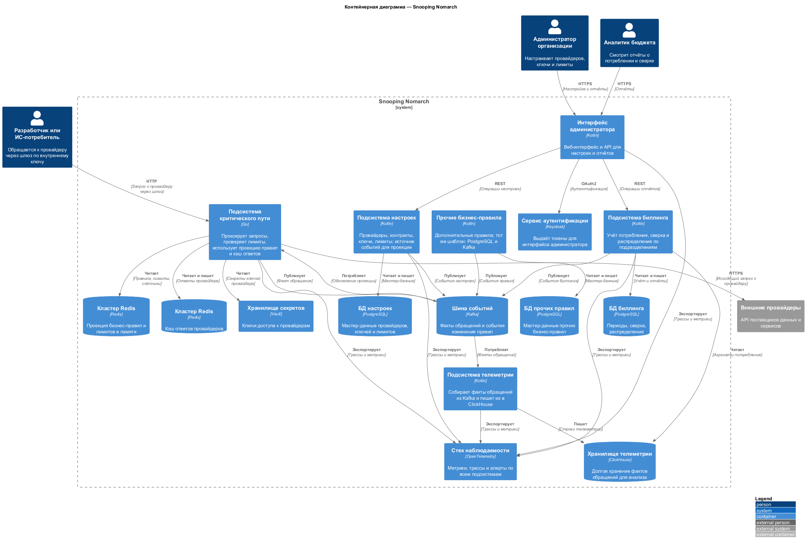

# Архитектурная модель Snooping Nomarch

Документ описывает верхнеуровневое устройство продукта на уровне контейнеров C4.
Смысл продукта, [ограниченные контексты](../../glossary/terms/bounded-context.md) и [атрибуты качества](../../glossary/terms/quality-attribute.md) заданы в [замысле продукта](../product-intent/index.md).

В репозитории `architecture` целевой источник правды о структуре системы — модель ArchiMate.
Это зафиксировано в [ssot.md](../../playbook/principles/ssot.md).
Диаграмма C4 здесь — обзорное представление для согласования подсистем и потоков данных.
Полная модель ArchiMate появится в этом репозитории отдельно.

Исходник диаграммы: [c4-container.puml](c4-container.puml).

## Контейнерная диаграмма

## Подсистемы

### Подсистема критического пути

Подсистема реализует [ограниченный контекст](../product-intent/05-bounded-contexts/CTX-03-proxying-and-caching/index.md) проксирования и кэширования.
Она же выполняет проверку лимитов из контекста [потребителей и лимитов](../product-intent/05-bounded-contexts/CTX-02-consumers-and-limits/index.md).

Сервисы написаны на Go.
Они обрабатывают каждый входящий [запрос](../../glossary/terms/request.md) с минимальной задержкой.
Правила и лимиты читают из кластера Redis с проекцией в памяти.
Ответы провайдера кэшируют в отдельном кластере Redis.
Секреты ключей провайдера читают из хранилища секретов.
После обработки подсистема публикует факт обращения в Kafka.
Она подписана на события из Kafka и обновляет проекцию правил и лимитов в Redis.

### Подсистема телеметрии

Подсистема собирает факты обращений из Kafka.
Она записывает их в ClickHouse для долгого хранения и анализа.
Сырые данные нужны для [учёта потребления](../product-intent/05-bounded-contexts/CTX-04-consumption-metering/index.md) и для [наблюдаемости](../product-intent/05-bounded-contexts/CTX-06-observability/index.md).
Путь обработки запроса не ждёт записи в ClickHouse.

### Подсистема настроек

Подсистема владеет мастер-данными [провайдеров и контрактов](../product-intent/05-bounded-contexts/CTX-01-providers-and-contracts/index.md) и [потребителей с лимитами](../product-intent/05-bounded-contexts/CTX-02-consumers-and-limits/index.md).
Она хранит их в PostgreSQL.
При изменении данных подсистема публикует событие в Kafka.
Подсистема критического пути применяет событие к проекции в Redis.

### Подсистема биллинга

Подсистема реализует [учёт потребления](../product-intent/05-bounded-contexts/CTX-04-consumption-metering/index.md) и [сверку с распределением](../product-intent/05-bounded-contexts/CTX-05-settlement-and-allocation/index.md).
Она хранит отчётные периоды и результаты сверки в PostgreSQL.
Агрегаты для отчётов читает из ClickHouse.
Она может публиковать события в Kafka для других подсистем.

### Прочие бизнес-правила

Дополнительные правила, которые не входят в настройки и биллинг, оформляют отдельными сервисами.
У каждого сервиса своя схема PostgreSQL и свой поток событий в Kafka.
Подсистема критического пути подписывается на нужные топики и обновляет проекцию.

### Интерфейс администратора

Веб-интерфейс и API дают администратору и аналитику доступ к настройкам и отчётам.
Серверная часть обращается к подсистеме настроек и подсистеме биллинга по REST.
Аутентификацию выполняет Keycloak.

### Стек наблюдаемости

Все подсистемы экспортируют метрики и трассы через OpenTelemetry.
На их основе строят дашборды и алерты о состоянии провайдеров и шлюза.

## Ключевые потоки

### Обработка запроса

ИС-потребитель отправляет HTTP-запрос в подсистему критического пути.
Сервис читает проекцию правил и лимитов из Redis.
Сервис проверяет лимит и при необходимости отдаёт ответ из кэша.
Иначе сервис запрашивает провайдера, используя секрет из хранилища.
Сервис возвращает ответ ИС и публикует факт обращения в Kafka.

### Телеметрия

Подсистема телеметрии читает факты обращений из Kafka.
Она пакетно записывает строки в ClickHouse.
Аналитик и подсистема биллинга используют ClickHouse для отчётов и агрегатов.

### Изменение правила или лимита

Администратор сохраняет изменение через интерфейс администратора.
Подсистема настроек фиксирует данные в PostgreSQL и публикует событие в Kafka.
Подсистема критического пути получает событие и обновляет проекцию в Redis.
Следующий запрос уже видит новое правило или лимит.

## Соответствие атрибутам качества

| Атрибут | Как архитектура это поддерживает |
| ------- | -------------------------------- |
| [QA-01](../product-intent/04-quality-attributes/QA-01-accounting-integrity.md) | Лимиты и счётчики на критическом пути; учёт по фактам в Kafka и ClickHouse |
| [QA-02](../product-intent/04-quality-attributes/QA-02-availability.md) | Горизонтальное масштабирование сервисов Go; кэш ответов при недоступности провайдера |
| [QA-03](../product-intent/04-quality-attributes/QA-03-latency-overhead.md) | Правила и лимиты в памяти Redis; без синхронной записи в ClickHouse на пути запроса |
| [QA-04](../product-intent/04-quality-attributes/QA-04-scalability.md) | Разделение критического пути, телеметрии и бизнес-подсистем |
| [QA-05](../product-intent/04-quality-attributes/QA-05-secret-and-data-protection.md) | Секреты провайдера только в хранилище секретов; вход в интерфейс через Keycloak |
| [QA-06](../product-intent/04-quality-attributes/QA-06-long-term-retention.md) | ClickHouse для долгого хранения фактов обращений |
| [QA-07](../product-intent/04-quality-attributes/QA-07-tenant-isolation.md) | Изоляция организаций в данных и в проекции (детали — в открытых вопросах) |
| [QA-08](../product-intent/04-quality-attributes/QA-08-configurability.md) | Новые провайдеры и ключи через подсистему настроек без изменения кода шлюза |

## Открытые вопросы и кандидаты в ADR

Следующие решения в этом документе не зафиксированы.
Их нужно оформить как [архитектурные решения](../../glossary/terms/architecture-decision.md) при согласовании.

- Язык и стек сервисов вне критического пути.
- Два кластера Redis: границы отказа и политика согласованности проекции.
- ClickHouse: схема данных, срок хранения, связь с учётом в PostgreSQL.
- Kafka: гарантии доставки фактов обращений и событий правил; версионирование сообщений (см. [ADR-26061101](../../ADR/ADR-26061101-kafka-message-semver-versioning.md)).
- Первичная загрузка проекции: снимок, компактные топики или полный пересчёт из PostgreSQL.
- Атомарные счётчики лимитов в Redis и согласование с учётом в биллинге.
- Поведение при отказе Redis, Kafka или провайдера: отказ запроса или ответ из устаревшего кэша.
- Изоляция организаций-покупателей в SaaS на уровне проекции, топиков и строк ClickHouse.
- Термины «критический путь» и «проекция бизнес-правил» — кандидаты в [глоссарий](../../glossary/index.md).
